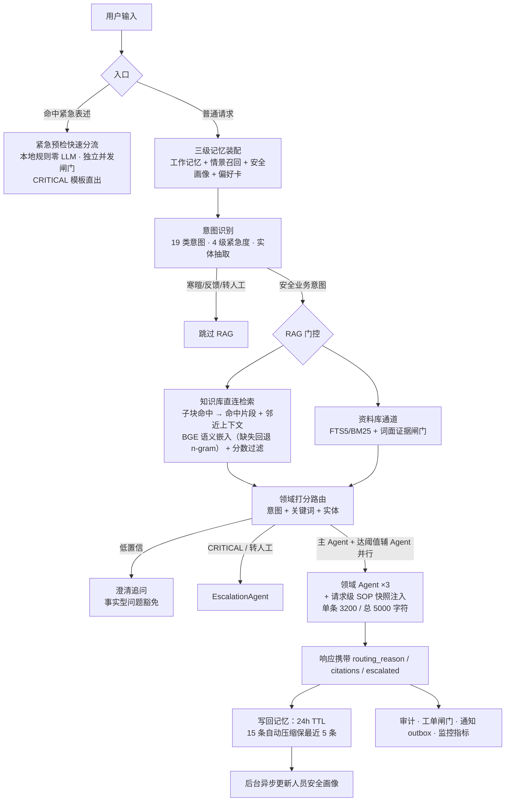
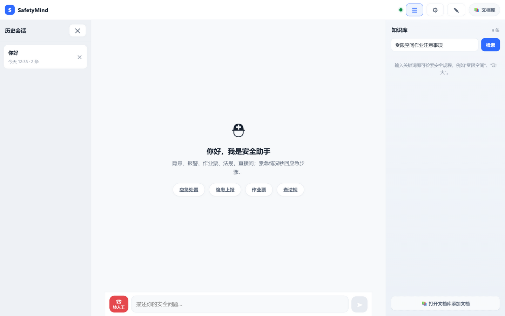
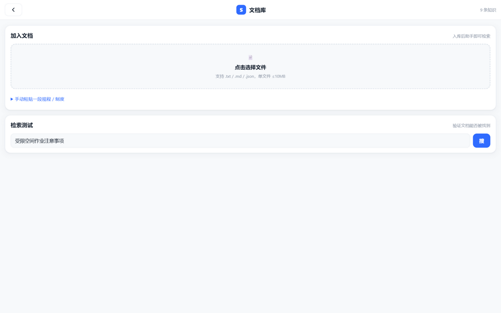
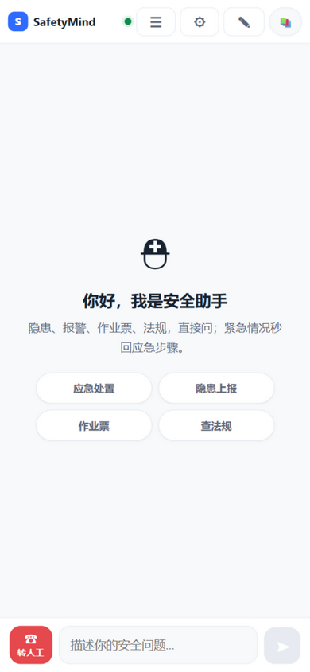

<p align="center">
  
</p>

<h1 align="center">SafetyMind</h1>

<p align="center"><b>面向工业安全生产的多 Agent 问答与隐患处置平台</b><br>
一句话输入 → 意图识别 → 安全知识检索 → 多 Agent 路由 → SOP 注入 → 工单/升级 → 全程留痕</p>

[](https://www.python.org/)
[](https://fastapi.tiangolo.com/)
[](https://vuejs.org/)
[](https://www.docker.com/)
[](docs/闭环接手手册.md)
[](core/llm_protocol.py)

> **当前状态（2026-11-09）**：19 轮无人值守闭环，93 条发现已修复 91、外部阻塞 2、待办 0；发布门禁 **104/104 全绿**；`main` 与远端同步。状态可随时用 `node scripts/loop-status.mjs` 复核。

> **要接手持续迭代？先读 [docs/闭环接手手册.md](docs/闭环接手手册.md)**：状态源在哪、一轮怎么做、门禁怎么跑、评测纪律与踩过的坑。进门一条命令：`node scripts/loop-status.mjs`。

<details>
<summary><b>目录</b></summary>

- [它解决什么问题](#它解决什么问题)
- [能力总览](#能力总览)
- [运行时链路](#运行时链路)
- [工单五阶段与治理闭环](#工单五阶段与治理闭环)
- [可评测性](#可评测性)
- [快速开始](#快速开始)
- [使用与部署](#使用与部署)
- [API](#api)
- [环境变量](#环境变量)
- [项目结构](#项目结构)
- [工程质量与闭环](#工程质量与闭环)
- [设计取舍](#设计取舍)
- [路线图与边界](#路线图与边界)
- [文档](#文档)
- [边界声明](#边界声明)

</details>

## 它解决什么问题

工业安全生产的问答不是普通聊天：**答错的代价不对称**。隐患上报被当闲聊回答是漏报，紧急事件排在普通请求后面是延误，自动建单没有授权依据是治理风险。通用聊天机器人能生成一段像样的话，但给不出可审计的处置链——依据从哪来、为什么转人工、谁授权建单、整改走到哪一步。

SafetyMind 把这条链拆成可测试、可观测、可回退的组件：**安全底线由确定性规则守，LLM 负责理解与表达**。紧急度独立于意图置信度，CRITICAL 模板先于一切澄清，隐患建单走纯规则闸门，工单流转有状态机与权限矩阵，所有拒绝、升级、通知、导出都留痕。前端默认只服务一线员工（对话/文档库/转人工），开发者信息收进 `?dev=1` 面板。

## 能力总览

| # | 能力 | 关键机制 | 主要代码 |
| --- | --- | --- | --- |
| ① | 意图与紧急度 | 19 类意图（15 类安全业务 + 4 类交互）、4 级紧急度、实体抽取；默认 LLM 0.7 / 向量 0.2 / 关键词 0.1 三路融合，可选本地 BGE 原型分类器级联（`SAFETYMIND_BGE=1`）与 Laya 判别式路由；参数名词表过滤，避免把「爆炸极限」误判为现场爆炸 | `core/intent_recognizer.py` `core/intent_bge.py` `core/param_phrases.py` |
| ② | 多 Agent 路由 | 员工层统一装配记忆/RAG/SOP 快照；3 个领域专家（协调/设备/合规）+ 升级 Agent；低置信先澄清，CRITICAL/转人工直达升级，辅 Agent 达阈值并行；专属失败降级兜底；每条响应带 `routing_reason` / `agent_types` / `supporting_agents` | `agents/agent_orchestrator.py` |
| ③ | RAG 与资料库 | 500 字句级重叠子块 + 父文档（返回截断 2400 字）；`/chat` 走直连向量检索（默认 BGE，缺失回退 n-gram）控制延迟，`/search` 提供「原始 + 3 个子查询」4 路改写 → 并行召回 → 去重 → LLM 重排；corpus 资料库通道 FTS5/BM25 + 词面证据闸门（默认 ≥2 个非泛用词命中）；引用带标题/章节/版本/命中片段，目录卡明确标注 `catalog_only` | `mcp/knowledge_base.py` `mcp/tool_manager.py` `corpus/` |
| ④ | 记忆与上下文 | Redis 工作记忆 24h TTL，15 条压缩保留最近 5 条 + LLM 摘要；Chroma 情景记忆跨会话语义召回；人员安全画像异步更新；偏好卡；可选证据指针窗口（`SAFETYMIND_CONTEXT_WINDOW=1`）——正文留在服务端，模型只拿短引用，展开受主体+会话双边界、TTL 与 sha256 完整性校验 | `memory/conversation_memory.py` `memory/evidence_pointers.py` `memory/preference_cards.py` |
| ⑤ | 工单五阶段 | 六状态（需求简报/过程研讨/执行产出/多轮反馈/验收通过/验收驳回）白名单流转；reporter/handler/verifier/admin 角色与主体范围；多用户形态验收仅 verifier/admin 且必须批注；`expected_from_stage` 乐观并发冲突 409；终态回退前授权快照续期校验，`/reauth` 只追加时间线不改历史 | `core/audit_store.py` `api/main.py` |
| ⑥ | 隐患闸门与准入 | 纯规则零 LLM：HIGH+ 自动建单、MEDIUM 给「上报隐患」确认卡（用户点击才建，防工单贬值）；按台账大类建议一般/重大定级并携带依据条款；派发部门与限期配置驱动（默认 48h / 168h，可按大类覆盖）；同用户 24h 同实体重复上报自动合并；准入三档 `off/observe/auto`（默认 off）与影子评审报告 | `core/hazard_gate.py` `core/admission.py` `core/shadow_report.py` |
| ⑦ | 技能运营 | 8 篇内置 SOP（MSDS/合规应急/设备工艺/隐患上报/动火票/月度检查/协调/台账）；SKILL.md 热加载；单条 3200 / 总量 5000 字符预算；候选 → 效果验证 → 双人审批 → 发布门禁 → 发布指针 → 回退/请求级回放；作者与发布审批者必须不同主体 | `core/skill_loader.py` `core/skill_evolution.py` |
| ⑧ | 台账与交付 | 5 类常用台账（隐患/检查/培训/作业票/应急演练，附法定依据）产出 xlsx/docx；验收摘要「预览取 data_hash → 授权导出 → 按主体下载」两步授权；同秒并发不覆写（独占认领 + `_2/_3` 冲突序号 + `os.replace` 原子发布） | `core/ledger_export.py` |
| ⑨ | 可靠通知与巡检 | 通知 outbox 同事务入队、幂等键、退避重试、失败可重放、接收方独立 ack；watchdog 只读巡检通知等待/失败/耗尽、渠道连败、工单逾期/卡单与 SOP 漂移，输出稳定事实码、责任范围与处理建议，业务表零写入 | `core/notification_outbox.py` `core/watchdog.py` |
| ⑩ | 可观测、评测与多用户安全 | Prometheus 指标 + 滑动窗口 Z-score + 路由惩罚；意图 F1 + LLM-as-Judge 四维 + 回归基线 + 发布门禁（RED 零容忍）；三级令牌（访问门/管理端/用户主体）与角色范围隔离，403 拒绝同样落审计 | `monitor/` `evaluation/` `core/auth.py` |

## 运行时链路



> 上图是 `/chat` 主链路。`/search` 是检索演示端点，走完整的 4 路查询改写与 LLM 重排；主链路刻意跳过这两跳，避免每多一跳 LLM 就多一秒级延迟。启用 `SAFETYMIND_BGE=1` 后，意图阶段由本地语义原型分类器级联替代（置信度达阈直出、跳过 LLM 调用），其余链路不变。

## 工单五阶段与治理闭环

```text
需求简报 brief → 过程研讨 discuss → 执行产出 execute → 多轮反馈 feedback → 验收通过 accept
                                                              ↘ 验收驳回 reject → 回到 feedback 重做
```

- **状态机是服务端唯一事实源**：合法边只有 `brief→discuss→execute→feedback→accept/reject`，`accept/reject` 可回退 `feedback`；非法跳转、未知阶段、重复同阶段一律拒绝。
- **权限矩阵**：多用户形态下验收动作仅 `verifier` / `admin` 且必须填写批注，处理者不能越权验收；本地单人形态沿用管理端可信边界。记忆、会话、审计、工单归属全部按 `X-User-Token` 解析出的主体隔离。
- **并发与追溯**：提交方可带 `expected_from_stage`，阶段已变返回 409 且零写动作；`/tickets/{id}/timeline` 记录建单简报、历次流转、批注、通知与补授权事件。
- **授权快照**：准入 `auto` 模式下自动建单携带不可变 `mandate_json`（主体/策略版本/依据/时间）；`model_hint` 这类随机成分不进授权链；终态回退前重新校验快照，失效则拒绝并留痕 `mandate_reauth_required`，补授权只能追加事件、不能改写历史。
- **验收摘要导出**：`preview` 返回业务字段与 `data_hash`，`export` 必须回传该哈希并在生成前重读数据库比对——预览后工单变化即「审批过期」409；多用户形态下下载按工单归属主体或管理员放行，产物归档带 sha256。
- **准入三档**：`off`（默认，逐字节保持现行为）/ `observe`（影子裁决只增观测数据）/ `auto`（获准试点）。`auto` 当前为 deny：业务签批与真实影子数据缺失，系统不会自动开启；管理端可查 `GET /admission/shadow-report` 的双轨分歧与确认率。
- **受限后台预演**：单场景、并发 1、墙钟/步数/提案数/TTL 四重预算，只读白名单；产物是待复核提案，审批时重验主体/策略/修订哈希/预算。当前仅库组件，未接生产调度（需业务批准）。

## 可评测性

不贴跑不出来的数字，只承诺每条链路都有对应的度量面：

| 链路环节 | 度量方式 | 入口 |
| --- | --- | --- |
| 意图识别 | Accuracy / Macro-F1 / 每类 P-R-F1，内置 13 条意图用例 | `POST /eval/run` |
| 回答质量 | LLM-as-Judge 四维评分（相关/准确/完整/可执行） | `POST /eval/run` |
| 性能回归 | 与上次基线对比，退化超 5% 自动标记 | `data/eval/baseline.json` |
| 发布门禁 | RED 违规无条件阻断 + 部署档阈值（通过率/p95/引用覆盖） | `POST /eval/gate` |
| Agent 在线表现 | 成功率 / 延迟 / 路由评分，滑动窗口 Z-score 异常检测 | `GET /monitor` |
| 工具健康 | 三态熔断 / 缓存命中率 / 连续失败数 | `GET /monitor` |
| 路由可解释 | 每条响应携带 `routing_reason` / intent / urgency / 各路得分 | `POST /chat` 响应体 |
| 流式一致性 | `/chat` 与 `/chat/stream` 事实层对照、失败必以 `error → done` 收尾 | `benchmarks/eval_stream_parity.py` |

### 意图识别基准

自建 19 类安全意图基准：数据文件共 2453 条（v3.1 审计版 2036 = dev 1003 / test 1033；独立留出 test2 文件 417 条，其中 7 条生成残留/歧义项在评测脚本中显式剔除，实际评测 410 条，剔除清单见 `benchmarks/intent/eval_prototype.py`），人机协同标注 + 五模型一致性审计（标注噪声率 0.9%），数据集与评测脚本随仓库开源（`benchmarks/intent/`）。

| 意图引擎 | 准确率（test n=1033，同口径） | 单条延迟 p50（CPU / GPU） |
| --- | --- | --- |
| **语义原型分类器（bge 双模型集成，零训练）** | **96.4%** | **94ms / 13ms** |
| LLM 三路融合 | 64.6% | 2047ms / — |
| pattern 关键词 | 56.5% | <1ms |
| Laya 判别式路由 | 55.6% | 305ms / 57.5ms |

- 独立留出集（test2）**94.9%**；分档：规范表述 97.4% / 口语改写 93.6% / 边界易混 81.3%
- 集成引擎已接入 `SAFETYMIND_BGE=1` 级联（置信度达阈直出、跳过 LLM 调用）；端到端 `/chat` 剖析与消融记录见 [docs/BENCHMARK.md](docs/BENCHMARK.md)
- 基准的方法、负结果、强模型对照与复现步骤均在 BENCHMARK.md；未采纳的方案也保留在文档里，不做事后美化

## 快速开始

```bash
python -m venv .venv
# Windows PowerShell: .venv\Scripts\Activate.ps1
source .venv/bin/activate
pip install -r requirements.txt

cp .env.example .env        # Windows: copy .env.example .env
# 填入 ANTHROPIC_API_KEY（或兼容 Anthropic / OpenAI 协议的第三方端点）

python desktop.pyw          # 桌面：原生窗口，双击即用
# 或
python -m api.main          # Web：http://127.0.0.1:8000
```

Docker 完整部署（含 Redis / ChromaDB / Prometheus / Nginx）：

```bash
cp .env.example .env    # 填入 ANTHROPIC_API_KEY
docker compose up -d    # 首次启动会导入 7 篇默认安全知识库文档
```

> [!WARNING]
> `.env` 已被 `.gitignore` 忽略，切勿提交 API key。第三方兼容端点通过 `ANTHROPIC_BASE_URL` 与
> `SAFETYMIND_LLM_PROTOCOL` 配置；这类端点通常不提供云端 embeddings，但默认的本地 n-gram/BGE 向量兜底不受影响。
> 只有显式 `SAFETYMIND_BGE=0` 且配置了 `ANTHROPIC_BASE_URL` 时，意图向量路才关闭并切换为 LLM 0.85 / 关键词 0.15。

<details>
<summary><b>模型兼容性（实测结论）</b></summary>

- 优先使用支持关闭 reasoning / thinking 的模型。不响应 `reasoning_effort` / `thinking` 的模型可能出现 `finish=length`、正文 0 字、思考内容吃掉全部预算；此时可配置 `SAFETYMIND_FALLBACK_MODEL` 换模型重试一次，系统不会再把内心独白当正文。
- OpenAI 协议适配层会把 `max_tokens` 抬到 ≥4096，`SAFETYMIND_MAX_TOKENS` 只能抬高、不能压低；预算加大救不回「思考不可控」的模型，换模型才是修法。
- 详细对照与复现：`benchmarks/eval_truncation_budget.py`、`core/llm_protocol.py`。

</details>

## 使用与部署

同一套后端，四种运行形态：

- **桌面**：双击 `desktop.pyw` —— pywebview 原生窗口，FastAPI 在窗口背后运行，关窗即退；首次双击自动创建虚拟环境并安装依赖。本地无 Redis/ChromaDB 时自动降级为进程内记忆（JSON 快照持久化，重启不丢）+ 嵌入式向量库（本地库损坏自动归档重建，不阻塞启动）。嵌入模式默认 `auto`：本地装有 `torch` + `transformers`（`pip install torch transformers`）时使用 BGE 语义向量（首次自动下载约 400MB 至 `HF_HOME`），否则自动回退 n-gram（可完全零下载离线启动）；设 `SAFETYMIND_EMBEDDING=ngram` 可强制零下载。启用本地意图引擎 `SAFETYMIND_BGE=1` 同样需要这两项可选依赖，首次需下载约 1.7GB 嵌入模型权重。
- **手机版窗口**：双击 `mobile.pyw` —— 后端已在跑时直接弹出 390×844 手机比例窗口（无地址栏），后端未运行时自动拉起；也可用浏览器手机模式访问同一地址。
- **Web**：`start_web.bat` 或 `python -m api.main` —— 浏览器访问 `http://127.0.0.1:8000`，前端由后端同源伺服。
- **Docker**：`docker compose up -d` —— Redis + ChromaDB + Prometheus + Nginx 完整生产编排。
- **服务器实测容量**：2 核 2GiB + BGE 本地引擎，20 并发混合负载 90 秒零崩溃（2026-10 压测；对话经并发闸门排队，检索/统计毫秒级；对话吞吐受免费模型限流约束，切付费模型立解）。
- **服务器部署**：Ubuntu + systemd + Caddy 自动 HTTPS 的完整步骤见 [docs/DEPLOY.md](docs/DEPLOY.md)（2 核 2GiB 实测可行，含 swap、验收清单与备份）。

Vue 3 前端（`frontend/`）提供对话、技能查看/热加载、知识库统计、检索演示、评测面板、监控面板，预构建产物随仓库分发，无需 Node 环境即可运行。

<p align="center">
  
</p>

<p align="center">
  
  
</p>

上图为**桌面对话页**（三栏：历史会话 / 对话区 / 知识库右栏，检索即点即出）与**文档库页**（上传、粘贴入库、检索测试）；小图为**手机端**（同一套代码按屏宽自适应，转人工常驻底部）。页面支持 `?view=chat|knowledge|evaluation` 深链接直达。

## API

| 域 | 端点 |
| --- | --- |
| 对话 | `POST /chat` · `POST /chat/stream` · `POST /search` · `POST /search/direct` |
| 知识库 | `POST /knowledge/add` · `POST /knowledge/upload` · `GET /knowledge/stats` · `GET /corpus/status` |
| 技能 | `GET /skills` · `POST /skills/reload` · `POST /feedback` · `GET/POST /skills/candidates*` · `POST /skills/revisions/{id}/approve` · `POST /skills/revisions/{id}/validation` · `POST /skills/revisions/{id}/publish` · `POST /skills/publish/rollback` · `GET /skills/publish/pointer` · `GET /skills/replay/{request_id}` · `GET /skills/debug` |
| 审计与工单 | `GET /audit` · `/audit/stats` · `/audit/ticket-effectiveness` · `/upgrades` · `GET/POST /tickets` · `POST /tickets/{id}/transition` · `POST /tickets/{id}/reauth` · `PATCH /tickets/{id}` · `GET /tickets/{id}/timeline` · `GET /tickets/overdue` · `POST /hazard/confirm` |
| 治理与巡检 | `GET /watchdog` · `GET /admission/shadow-report` · `GET/POST /config/admin` · `POST /config/admin/bootstrap` |
| 台账 | `GET /ledger/templates` · `POST /ledger/export` · `POST /ledger/acceptance-summary/preview` · `POST /ledger/acceptance-summary/export` · `GET /ledger/acceptance-summary/{id}/download` |
| 评测与监控 | `GET /monitor` · `GET /metrics` · `POST /eval/run` · `GET /eval/last` · `POST /eval/gate` |
| 通知 | `GET /notifications` · `POST /notifications/{id}/replay` · `POST /notifications/{id}/ack` |
| 会话与配置 | `GET /conversations` · `GET /conversations/{id}/messages` · `DELETE /conversations/{id}` · `GET /health` · `GET /config` |

设置 `ACCESS_TOKEN` 后，除健康检查/用户端配置/前端静态资源外，以上业务端点均要求请求头 `X-Access-Token`（发给使用者的口令，前端「设置」页填一次即记住）。管理端点另需 `X-Admin-Token`；多用户形态下 `SAFETYMIND_USERS` 配置主体目录，业务请求可携带 `X-User-Token` 绑定主体与资料范围。前端通过 `/api/python/*` 前缀访问以上接口（与 Nginx 反代路径一致），后端已同时挂载两套路径。

### `/chat/stream` 事件契约

| 事件 | 何时发 | data 关键字段 |
| --- | --- | --- |
| `meta` | 请求一进来 | `emergency`、`message`（前 60 字） |
| `stage` | 排队 / 开始处理 | `stage`（`queued`/`processing`）、`lane` |
| `delta` | 答案分块 | `text` |
| `error` | 排队超时或生成异常 | `code`（`queue_timeout`/`internal_error`）、`message`、`retry_after` |
| `done` | **每次都发**（含失败） | 完整响应体（`response`/`citations`/`escalated`/`hazard*`/`conversation_id`）+ `path` |

要点：失败也必须以 `error → done` 收尾（`done.response` 是可读提示），客户端才不会看到「半截流」；客户端断开时服务端会立刻释放并发容量（`tests/test_stream_gate_leak.py` 锁定）。前端把 `error.code=queue_timeout` 渲染成「排队超时，本次没有生成回答。+ 建议 N 秒后重试 +【重试】」，点击重试复用上一条用户消息。

`escalated=true` 时响应附带 `escalation_basis`：`urgency`（CRITICAL 紧急度）/ `intent`（意图即转人工）/ `safety_net`（本地紧急预检兜底）是确定性依据，`model_hint`（模型正文出现「建议转人工」等关键词）取决于生成文本，同一问题两次可能不同。测试与自动化应断言 `escalation_basis`，不要只断言 `escalated`。

## 环境变量

| 变量 | 默认 | 说明 |
| --- | --- | --- |
| `ANTHROPIC_API_KEY` | 必填 | LLM 调用凭证 |
| `ANTHROPIC_BASE_URL` | 官方 | 兼容 Anthropic 协议的第三方端点 |
| `ANTHROPIC_MODEL` | `claude-3-5-sonnet-20241022` | 模型名 |
| `SAFETYMIND_LLM_PROTOCOL` | `anthropic` | `anthropic` / `openai`（OpenAI 兼容中继） |
| `SAFETYMIND_MAX_TOKENS` | `1024` | 生成输出预算（OpenAI 适配层会抬到 ≥4096） |
| `SAFETYMIND_FALLBACK_MODEL` | 空 | 主模型「思考吃光预算、正文 0 字」时换模型重试一次 |
| `SAFETYMIND_INTENT_MODEL` | 空（沿用生成模型） | 意图识别专用模型，低置信回落可显著降延迟 |
| `SAFETYMIND_EMBEDDING` | `auto` | RAG/记忆嵌入：`auto`（bge 可用即用，缺失回退 n-gram）/ `bge` / `ngram` |
| `SAFETYMIND_BGE` | 未设置（嵌入路默认开） | `1` 启用 bge 原型分类器级联（意图本地直出）；`0` 关闭本地级联（配合 `ANTHROPIC_BASE_URL` 时连向量路一起关闭） |
| `SAFETYMIND_BGE_LARGE` | 关闭 | `1` 叠加 bge-large 集成（准确率 +0.5pp） |
| `SAFETYMIND_INTENT_BGE` | `1` | 仅控制意图 BGE 级联；`0` 回退旧行为（不影响 RAG 嵌入） |
| `SAFETYMIND_BGE_TAU` | `0.8` | 级联直出置信度阈值 |
| `SAFETYMIND_LAYA` | 关闭 | `1` 启用 Laya 判别式路由备选引擎 |
| `REDIS_URL` | `redis://localhost:6379/0` | 工作记忆（不可用时自动进程内降级） |
| `CHROMA_HOST/PORT` | `localhost:8001` | 向量库（不可用时嵌入式降级） |
| `CHROMA_KB_PERSIST_DIRECTORY` | `./data/kb_chroma` | RAG 知识库本地向量目录（与对话记忆库分离，损坏自愈互不连坐） |
| `SAFETYMIND_MEMORY_SNAPSHOT` | `data/memory_snapshot.json` | 桌面模式记忆快照路径 |
| `SAFETYMIND_RAG_MIN_SCORE` | `0` | 知识库注入分数下限（默认丢弃负分与零分片段） |
| `SAFETYMIND_CORPUS_MIN_TERM_HITS` | `2` | corpus 注入闸门：≥N 个非泛用查询词逐字命中才注入；`0` 关闭 |
| `SAFETYMIND_CONTEXT_WINDOW` | `0` | `1` 启用证据指针与上下文窗口裁剪 |
| `HF_HOME` | 平台默认 | 本地嵌入模型缓存目录（默认写 C 盘用户缓存数百 MB，建议指向数据盘） |
| `AUDIT_ENABLED` / `AUDIT_DB_PATH` | `1` / `./data/audit.db` | 审计 + 工单 + 通知 + 巡检（SQLite 单文件） |
| `ESCALATION_WEBHOOK_URL` | 空 | 值班群机器人 webhook（企业微信/钉钉/飞书文本格式）；留空=仅落库 |
| `SAFETYMIND_HAZARD_AUTOTICKET` | `1` | 隐患闸门总开关；`0` 关闭自动建单与建议卡 |
| `SAFETYMIND_HAZARD_DISPATCH` | 内置种子 | 派发规则 JSON 路径（运行时副本优先，按台账大类/关键词配置部门与限期） |
| `SAFETYMIND_OUTBOX_ENABLED` | `1` | 通知发件箱与重试循环 |
| `SAFETYMIND_WATCHDOG_ENABLED` | `1` | 只读巡检（逾期/卡单/通知/SOP 漂移） |
| `SAFETYMIND_ADMISSION_MODE` | `off` | 准入三档 `off/observe/auto`；`auto` 需业务签批，默认不开启 |
| `ADMIN_TOKEN` | 空 | 管理密码：保护审计/工单/配置/技能发布/台账导出等管理端点（`X-Admin-Token`）。网络部署必须设置，留空=管理端点锁定 |
| `ACCESS_TOKEN` | 空 | 公网访问口令：设置后所有业务端点要求 `X-Access-Token`；留空=本地自用 |
| `SAFETYMIND_USERS` | 空 | 多用户主体目录 JSON（token → subject_id / roles / scopes），启用主体隔离 |
| `API_HOST` | `127.0.0.1`（desktop/mobile 启动器自动设置） | 监听地址；`python -m api.main` 默认 `0.0.0.0`，网络暴露时必须配置两个令牌 |
| `SAFETYMIND_DEPLOYED` | 空 | 服务器反代部署标记：设 `1` 后管理端点强制鉴权（防绑定地址欺骗免密）；桌面端勿设 |
| `CHAT_MAX_CONCURRENCY` | `4` | 对话链路并发闸门（LLM/torch 限流保护） |
| `FAST_LANE_MAX_CONCURRENCY` | `8` | 纯化学品查询快车道闸门 |
| `EMERGENCY_MAX_CONCURRENCY` | `8` | 紧急预检快速通道闸门（不排普通队列） |
| `SAFETYMIND_TORCH_THREADS` | 自适应 `max(1,min(4,cpu//2))` | 嵌入推理线程数；2 核机器自动保持 1 线程 |

<details>
<summary><b>进阶开关与运维参数</b></summary>

| 变量 | 默认 | 说明 |
| --- | --- | --- |
| `SAFETYMIND_TEMPERATURE` | 不设置 | 生成采样温度；评测复现用 `0`，默认不发送该字段 |
| `SAFETYMIND_ANSWER_STYLE` | 不设置 | `brief` = 先结论/最多 5 条/450 字内（默认关闭） |
| `SAFETYMIND_INTENT_LLM_TIMEOUT_S` | `0`（关闭） | 意图 LLM 回落超时；开启属「准确率换延迟」取舍 |
| `SAFETYMIND_CRITICAL_TEMPLATE` | `1` | `0` 关闭 CRITICAL 模板化零 LLM 应急响应 |
| `SAFETYMIND_EMERGENCY_FASTPATH` | `1` | 紧急预检快速分流开关 |
| `SAFETYMIND_DETERMINISTIC_FASTPATH` | `1` | 纯化学品参数查询命中资源库时模板化直出 |
| `SAFETYMIND_CLARIFY` | `1` | 低置信带澄清式反问；事实型问题自动豁免 |
| `SAFETYMIND_HAZARD_OVERDUE_CHECK` / `_S` | 开启 / 内置间隔 | 工单逾期巡检与升级提醒 |
| `SAFETYMIND_ADMISSION_OBSERVE_SCOPE` | 空 | `hazard` = 闸门 auto 降级为待复核建议卡（observe 收口） |
| `SAFETYMIND_ADMISSION_AUTO_SUBJECTS` | 空 | auto 试点的建单主体白名单 |
| `SAFETYMIND_LEDGER_OUT_DIR` | `D:/SafetyMindData/台账输出` | 台账与验收摘要产物目录（测试可钉隔离目录） |
| `SAFETYMIND_SKILLS_DIR` | `./skills` | SKILL.md 目录 |
| `SAFETYMIND_SKILLS_MAX_PROMPT_CHARS` | `5000` | Skill 注入总字符预算（单条 3200） |
| `SAFETYMIND_SKILL_EVOLUTION` | `1` | 技能候选/自进化入口 |
| `SAFETYMIND_WATCHDOG_INTERVAL_S` / `_STUCK_S` | 内置 | 巡检间隔与卡单判定时长 |
| `SAFETYMIND_WATCHDOG_TOKEN` | 空 | 部署形态只读巡检令牌（`X-Watchdog-Token`），仅放行 `GET /watchdog`；管理写端点仍只认 `ADMIN_TOKEN` |
| `SAFETYMIND_OUTBOX_INTERVAL_S` / `_BATCH` / `_MAX_ATTEMPTS` | 内置 | 通知发件箱节奏与最大重试次数 |
| `SAFETYMIND_CACHE_TTL_S` / `SAFETYMIND_CACHE_MAX` | `21600` / `512` | 回复缓存 TTL 与 LRU 上限 |
| `SAFETYMIND_DISK_FREE_GUARD_BYTES` | 内置 | 资料库下载/构建磁盘余量守卫 |
| `PROMETHEUS_PORT` | 关闭 | 指标独立端口；`0` 可避 Windows 保留端口冲突 |
| `EVAL_BASELINE_PATH` | `./data/eval/baseline.json` | 回归基线 |
| `EVAL_GATE_RECORD_PATH` | `./data/eval/last_gate.json` | 发布门禁判决记录 |

</details>

## 项目结构

```text
SafetyMind/
├── desktop.pyw / mobile.pyw        # 桌面 / 手机窗口启动器（单实例锁 + 启动日志 + 超时保底）
├── start_web.bat                   # Web 一键启动
├── api/main.py                     # FastAPI 入口：同源前端 + 访问门 + 并发闸门 + 全部端点
├── agents/agent_orchestrator.py    # 员工层编排 + 3 领域 Agent + 升级 Agent
├── core/
│   ├── intent_recognizer.py        # 19 类意图 + 4 级紧急度 + 三路融合
│   ├── intent_bge.py               # bge 语义原型分类器（零训练级联）
│   ├── laya_recognizer.py          # Laya 判别式路由备选引擎
│   ├── hazard_gate.py              # 隐患分层闸门（纯规则零 LLM）
│   ├── admission.py                # 准入三档 + 不可变授权快照
│   ├── emergency.py                # 紧急预检 / CRITICAL 模板
│   ├── param_phrases.py            # 「爆炸极限」类参数名词表过滤
│   ├── audit_store.py              # SQLite：审计/工单五阶段/通知 outbox/巡检/预算/验收归档
│   ├── ledger_export.py            # 5 类法定台账 xlsx/docx + 验收摘要导出
│   ├── skill_loader.py             # SOP 注入 + 发布指针 / 回退 / 请求级回放
│   ├── skill_evolution.py          # 技能候选与审批
│   ├── skill_effect_validation.py  # 技能效果前后对照
│   ├── watchdog.py                 # 只读巡检（稳定事实码 + 责任范围 + 建议）
│   ├── rehearsal.py                # 受限后台预演与待复核提案（未接生产）
│   ├── shadow_report.py            # 准入影子评审报告
│   ├── notification_outbox.py      # 通知发件箱
│   ├── auth.py                     # 主体目录 / 角色 / 资料范围
│   ├── llm_protocol.py             # Anthropic / OpenAI 协议适配与降级
│   ├── bge_embedding.py            # BGE 语义嵌入（惰性导入，缺失回退 n-gram）
│   ├── local_embedding.py          # n-gram 兜底嵌入
│   ├── response_cache.py           # 回复缓存（知识库版本键 + TTL + LRU）
│   ├── env_config.py               # .env 白名单可视化配置（掩码/原子写）
│   └── chroma_utils.py             # 本地向量库损坏自愈（归档重建）
├── memory/                         # 三级记忆 + 会话持久化 + 偏好卡 + 证据指针
├── mcp/                            # 工具治理（熔断/缓存/重排）+ 知识库 + 资源库
├── corpus/                         # 资料采集/解析/切块/FTS5/目录卡/构建
├── evaluation/                     # 意图 F1 + LLM-as-Judge + 归因 + 发布门禁 + 部署档
├── monitor/                        # Prometheus + Z-score + 路由惩罚反馈
├── skills/                         # 8 篇可运营 SOP（SKILL.md，热加载）
├── frontend/                       # Vue 3 前端（移动优先 + 桌面三栏，预构建 dist）
├── benchmarks/intent/              # 2453 条意图基准 + 复现脚本 + 盲测工具包
├── benchmarks/                     # 失败率/事实稳定/流式一致性/闸门 A/B/模型对照等评测脚本
├── tests/                          # 102 个测试模块（单元/对抗/契约/浏览器接线）
├── docs/                           # 基准、部署、决策、接手手册、安全事件报告
├── config/ · deploy/               # Nginx / Prometheus；systemd unit + Caddyfile
└── docker-compose.yml              # 生产编排
```

## 工程质量与闭环

这个仓库不是「演示完就停」的原型。每轮迭代按固定六步推进：**从真实评测数据里找可证伪的问题 → 先写决策规则 → 实施最小改动 → 红灯测试先行 → 跑发布门禁 → 落台账并推送**。

| 维度 | 当前事实（2026-11-09） |
| --- | --- |
| 闭环轮次 | 19 轮无人值守迭代 |
| 发现池 | 93 条：91 已修复 / 2 外部阻塞 / 0 待办 |
| 发布门禁 | 104 个脚本全绿（core / heavy / corpus / infra 四组） |
| 测试规模 | `tests/` 下 102 个测试模块；每个新端点/钩子必须带测试 |
| 远端 | `main` 与 `origin/main` 同步，工作区干净 |
| 提交守卫 | 11 类密钥规则 + 7 类隐私规则；public 仓库提交前全量扫描 |

- **门禁不是「跑过就算」**：门禁 v2 runner 绑定仓库、提交 SHA、解释器版本与隔离目录，未知分组、空清单、清单外脚本、非预期 SHA、脏树未声明、旧产物复用一律在执行前非零拒绝；exit 0 但无统计行按失败处理。
- **不许改测试凑绿**：测试失败只能改产品代码；禁止删测试、弱化断言、放宽容差。意图基准基线 dev 97.71 / test 96.42 / test2 94.88，容差 ±0.3pp，退化必须回滚。
- **评测纪律**：A/B 必须控温 `SAFETYMIND_TEMPERATURE=0`；批量判分退避 + 节奏；多臂实验每臂独立进程，禁止 `importlib.reload(api.main)` 切臂。
- **阻断不是完成**：外部条件不具备的任务标 `blocked` 并写明依赖，不伪装成已完成；两条阻塞项在交接手册中单列，需仓库所有者侧处理。
- **安全是硬约束**：凭据只从 `.env` 读取（唯一入口 `benchmarks/_creds.py`），代码里禁止写死密钥；提交前跑 `node scripts/git-round.mjs --check`，扫全部已跟踪文件与候选文件。

## 设计取舍

- **意图层为什么用分类器而不是全交给大模型**：安全生产的误路由代价不对称——隐患上报被当闲聊回答是漏报。封闭意图集 + 显式紧急度门控是可测试、可审计的升级触发器（`/eval/run` 直接度量），一句「请模型自行判断是否升级」的 prompt 做不到。
- **三路融合的诚实边界**：官方 Anthropic SDK 无 embeddings 资源，向量路默认是本地字符 n-gram 哈希——词面近似而非语义检索；配置第三方 `base_url` 不会自动禁用它（本地计算不需要网络），只有显式 `SAFETYMIND_BGE=0` 且配置了 `base_url` 时才关闭并切换权重为 0.85/0.15。该弱点已在两侧解决：意图侧可启用本地语义原型分类器（基准 96.4%/94.9%），RAG 侧嵌入式模式在 `torch` + `transformers` 可用时使用 BGE 语义嵌入（定向查询命中对照见 BENCHMARK.md §8）。`SAFETYMIND_EMBEDDING=auto` 在 BGE 可用时即使用语义嵌入，缺失才回退 n-gram。
- **父子召回的取舍**：法规文档一句话命中时，500 字子块往往缺少条款限定语境，因此检索子块、返回父文档上下文（入库截断 6000 字、返回截断 2400 字）；相邻子块共享边界句，降低关键限定词被切断的概率。
- **Agent 层的兑现条件**：当前价值在 SOP 隔离、升级保障、权限矩阵与可观测路由；客户侧工单系统与 DCS 实时报警尚未接入，接上之后才是完整的工具编排收益。

## 路线图与边界

| 状态 | 事项 |
| --- | --- |
| 已上线 | 工单五阶段与权限矩阵、验收摘要两步授权导出、只读巡检 watchdog、通知 outbox、技能发布门禁/回退/回放、审计拒绝留痕、证据指针窗口（可选） |
| 待业务签批 | 准入 `observe` / `auto` 试点（当前 deny、默认 off）；受限后台预演接入生产调度 |
| 待外部系统 | 客户侧工单系统 REST 出站、DCS / 实时报警订阅 |
| 待评测 | 强模型对照复测、人工盲测回填（工具包已随仓库提供） |
| 待部署 | 域名 + HTTPS（Caddy 配置已备，当前内测形态为 IP 直连 + 访问门） |
| 明确未做 | 前端 token 级流式、多端点分流、部分本机路径硬编码的隐私清理 |

> 未做项不写成已完成。准入自动动作、生产写入口与外部系统对接都必须经过业务批准；代码里有开关，不等于业务上已启用。

## 文档

| 文档 | 内容 |
| --- | --- |
| [docs/闭环接手手册.md](docs/闭环接手手册.md) | 状态源、每轮 SOP、门禁、评测纪律、坑清单、当前快照 |
| [docs/BENCHMARK.md](docs/BENCHMARK.md) | 意图基准完整方法、负结果、强模型对照与复现步骤 |
| [docs/DEPLOY.md](docs/DEPLOY.md) | Ubuntu + systemd + Caddy 部署、swap、验收与备份 |
| [docs/PERF_AND_RAG_DECISIONS.md](docs/PERF_AND_RAG_DECISIONS.md) | 性能与 RAG 的取舍记录 |
| [docs/评测工业化改造报告.md](docs/评测工业化改造报告.md) | 评测漏斗、归因与发布门禁的工程化过程 |
| [docs/RESOURCE_LIBRARY.md](docs/RESOURCE_LIBRARY.md) | 资源库（MSDS / 资料目录 / 台账支撑文件）设计与集成 |

## 边界声明

SafetyMind 提供辅助信息与流程引导，**不替代现场安全规程、持证人员的判断与法定审批**。法规条款以最新正式文本为准；模型生成内容可能出错，涉及紧急处置、验收、定级与建单时必须由授权人员确认。自动建单、通知与准入策略均可在配置层关闭或降级。

---

<p align="center"><sub>规则守安全底线，模型负责理解与表达；每个结论都留痕，每次改动都有门禁。</sub></p>
