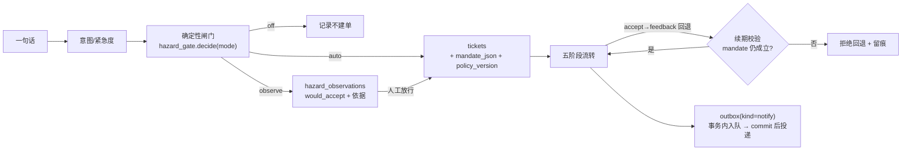

# 对标笔记：dsh-superagent-prototype → SafetyMind 可迁移机制

> 本文不是项目介绍，是**迁移决策的书面依据**。每条结论都带可复核的代码锚点或"已检索无命中"的否定证据；
> 引用范围止于能用 grep 点到的东西，**不含任何只存在于公开文章、仓库里查不到的说法**。

- 对标对象：`deepseek-ai/dsh-superagent-prototype`（MIT，TypeScript，DSH bundle）
- 快照：upstream `main` @ `8c32a9d`（2026-10-31T12:06:31Z）；本地曾克隆到 `6337fc8`，两者**工作树完全相同**（上游做过一次 commit 重写，`git diff --name-only 6337fc8 8c32a9d` 为空）
- 规模（该快照实测）：`src/` 110 个 ts/tsx 共 14,860 行；`tests/` 59 个 spec 共 13,537 行；`docs/` 9 篇编号文档共 1,431 行；`prompts/` 15 篇
- SafetyMind 基线：`main` @ `2eeb3fa`（2026-11-06 核对）；`tests/test_*.py` 81 个
- 核对方式：逐文件读取 + 全量关键词检索（结论见 §1、§2 "否定证据"列）
- **路径约定**：下文 `docs/…`、`src/…`、`tests/*.spec.ts` 均为 **dsh 仓库内**路径；`core/…`、`api/…`、`agents/…`、`mcp/…`、`tests/test_*.py`、`scripts/…` 为 **本仓库**路径
- 复核方式：见 §7

行号锚点基于上述快照；下文每条同时给出**符号名**（函数/类/常量），代码变动后按符号重新定位即可。

---

## 1. 先把事实基线钉住：文章 ≠ 仓库

仓库 README 自己划了线（`README.md:3` "Research prototype… not production-ready"；`README.md:5` "Some designs discussed in the article are directions for future development and **are not implemented in this prototype**"）。

对公开长文里出现的能力逐条检索（范围：`docs/*.md`、`src/**/*.ts`、`README.md`、`SETUP.md`）：

| 文章说法 | 仓库检索结果 | 结论 |
|---|---|---|
| Router + Worker 双层，Router 不下场干活 | 有。`src/app/sessions.ts:48`（`WORKER_PRESET`/`ROUTER_PRESET`）、`:61`（`WORK_TOOLS` 收窄）、`:77`（`noWait` 守卫） | 可用。**但 Router 仍持有 bash**，靠守卫而非去工具实现"不干活" |
| 两级事件过滤：确定性 Fast Path + 模型 Slow Path | 有，且比文章更细：`Policy.gate()`（`src/core/ports.ts:17`）+ 准入表（`docs/002-authorization.md` §Admission） | 可用 |
| 订阅直通，绕过编排层决策 | 有。`docs/001-domain.md` §Subscription：扇出只给上下文、不授予权限 | 可用 |
| Inline / Spill + 链式召回 | 有等价物：窗口 + 截断 + 按 id 展开（`src/app/assessment.ts:37` 的 `TRIGGER_CHARS/NEAR_CHARS/WINDOW_CHARS/STUB_CHARS`） | 可用（术语不同） |
| 后台"投机执行"（未下令先修） | `speculat`：**0 命中**（docs + src）。最接近的是 `observe` 模式：只记 `would_accept`，不动手（`src/policy.ts:57`） | **不可引用** |
| 外部 Watchdog 定时唤醒、自然语言问故障 | `watchdog`：**0 命中** | **不可引用** |
| 存算分离 / BYOM / 本地无状态 daemon | `BYOM`、`daemon`：**0 命中** | **不可引用** |
| 30% 决策数、37% 缓存 token、6.4s→1.6s、p95 15.7 vs 29.5 分钟 | 在 `docs/`、`README.md`、`SETUP.md` 中 `30%`、`37%`、`15.7`、`29.5`、`6.4`、`1.6 ` **全部 0 命中** | **不可引用**，无复现脚本 |

**这条直接决定引用纪律**：按仓库根约定"写进简历/答辩的每个机制都要能在代码里点到"，只允许引用上表"可用"行；"不可引用"行最多写成"公开文章提到的演进方向"。

---

## 2. 逐机制对照（SafetyMind 现状带锚点）

| # | dsh 机制 | dsh 锚点 | SafetyMind 现状 | 判定 |
|---|---|---|---|---|
| 1 | 两阶段准入：确定性 gate 判"谁能发起"，模型判"要不要做" | `Policy.gate()` `src/core/ports.ts:17`；三格准入表 `docs/002-authorization.md` §Admission | 已有确定性闸门：`core/hazard_gate.py` `decide()`（纯规则零 LLM），升级依据 `agents/agent_orchestrator.py` `escalation_basis()` | **语义已具备**，缺"准入面可运营配置" |
| 2 | accept mode `off` / `observe` / `auto`，默认 `observe` | `src/policy.ts:84`（`z.enum(['off','observe','auto']).default('observe')`）；`:57` 记 `would_accept` | **无**。`policy_version`/`would_accept`/`accept_mode`/`mandate` 在 `core/`、`api/`、`agents/` 全为 **0 命中**；`escalated` 直接建单（`api/main.py:1515`、`:1531`）；隐患 HIGH+ 由 `hazard_gate` 直接 auto 建单（`api/main.py:1581`） | **P0 搬** |
| 3 | Mandate 不可变授权 + Policy 版本 + 续期校验 | `MandateBasis` `src/core/model.ts:116`；`revalidate(mandate)` `src/policy.ts:213`；`policyChanged` `src/core/engine.ts:255` | **无**。`create_ticket()`（`core/audit_store.py:471`）只把 brief 写进 timeline，不记录"凭什么建这张单"；无 policy 版本字段 | **P0 搬（只搬快照+续期，不搬整条 Ticket 生命周期）** |
| 4 | Effects：事务内入队、commit 后执行、幂等合并、指数退避、`Later` 语义、每类一条健康项、**连败 3 次才报错** | `Later` `src/app/effects.ts:5`；`FAILURES_BEFORE_ERROR = 3` `:7`；`enqueue` `:61` | 已有一半：`create_ticket` 与 outbox **同事务落库**（`core/audit_store.py:517`）；`claim_pending_notifications` 用 `BEGIN IMMEDIATE` + 条件更新保跨进程不重复（`:338`）；`reap_stale_sending` 复位悬挂（`:412`）；退避 5s→300s（`core/notification_outbox.py:19`） | **P0 补齐（增量，不重写）**：缺 kind 分类、缺"暂时没条件≠失败"、缺按类健康项 |
| 5 | 工单阶段表：`first matching row wins` 纯函数 | `ticketStage()` `src/core/stage.ts:9`；`canRetry()` `:24` | 数据层有：`TICKET_STAGES` `core/audit_store.py:129`、`_STAGE_TRANSITIONS` `:135`、`transition_ticket` 白名单 `:571`。判定逻辑散在 API 调用点（`api/main.py` 多处），无单一纯函数 | **P0 抽纯函数** |
| 6 | 窗口 + stub + read pointer（模型只看邻近，其余按 id 取） | `src/app/assessment.ts:37`；资源分页 `src/app/resources.ts` | RAG 侧已做父子召回与改写；但工单时间线、历史会话仍是整段进上下文 | **P1** |
| 7 | Prompt/SOP 分片可覆盖 + 不可变版本 + **每个 Session 记录用过哪版** | `TEAM_SECTIONS` `src/app/prompts.ts:14`；`builtInParts` `:55`；`Versions` `src/app/versions.ts:10`；`Sessions` 落 `KV.sessions.prompts` | SKILL.md 有字符预算（`core/skill_loader.py:46` 单条 3200、`:78` 总量 5000）与热加载，**无版本、无"这次回答用的是哪版 SOP"** | **P1（审计价值高于性能价值）** |
| 8 | 注意力预算：路由备注 ≤30 词、聊天 ≤100 词、只在"人要动手/结果可用/做不完"时说话 | `IM_WORDS = 100` `src/infra/text.ts:3`；`NOTE_WORDS = 30` `:4`；`docs/004-prompts.md` §Principles | 产品形态不同（SafetyMind 是用户主动发起的对话），"少说话"不适用；但**通知面**（webhook/卡片文案）适用 | **部分借** |
| 9 | 文档即测试：编号连续、只引更早文档、模块表/测试表全覆盖、每个类必须有 JSDoc、模型面有体积预算 | `tests/docs.spec.ts`（`:39` 连续编号、`:41` 只引更早、`:58` 模块表、`:63` 测试表）；`tests/class-docs.spec.ts`；`tests/model-surface.spec.ts` 的 `BUDGET`（orchestrator 59,000 / worker 40,500 字符） | 无对应检查 | **P0 借（低风险高收益）** |

---

## 3. 三档清单

### P0 · 可直接搬（增量改造，风险低）

**A1 · 建单前加一档 `observe`**

- 落点：`core/hazard_gate.py` `decide()` 增加 `mode`（`off` / `observe` / `auto`）；`api/main.py` 建单分支按 mode 分流。
- `observe` 行为：不建单、不通知，把 `would_accept + 定级 + 依据条款 + 命中大类 + 派发/限期` 落到新表 `hazard_observations`。
- 为什么值得：直接量化"自动建单是否贬值"。现有 `suggest`（`api/main.py:1596` + `/hazard/confirm` `:1005`）只覆盖 MEDIUM 档，HIGH+ 档仍是**不可观测的自动动作**。
- 验收：三模式单测；`/eval` 能输出"观察期本会建 N 单 vs 实际建 M 单"；`observe` 下 `tickets` 表行数不变。

**A2 · 工单落不可变授权快照 + 续期校验**

- 落点：`tickets` 表非破坏加列 `mandate_json`、`policy_version`（沿用 `_migrate_locked` 的 ALTER ADD COLUMN 范式，`core/audit_store.py:166`）；`create_ticket()` 建单时一次写入：来源请求、强度（explicit/inferred）、命中的规则或闸门分支、policy 版本、上报人。
- 续期校验：`transition_ticket()`（`:571`）在 `accept → feedback`（回退重做）前校验快照仍成立；不成立则拒绝回退并计入 timeline，不静默复活。
- **约束**：人工改判（`update_ticket_fields`，`:839`）**不得改写 mandate**，只追加 timeline——这是 dsh "只有 accept / 人 stop / 续期失败三种操作能动授权"的最小对应。
- 验收：`mandate` 改判后不变；停用 `hazard_dispatch` 规则后旧单不能回退复活。

**A3 · 工单阶段判定收成纯函数**

- 落点：新增 `core/ticket_stage.py`，`ticket_stage(ticket) -> (group, action)` + `can_retry(ticket)`，逐行对齐 dsh `ticketStage()` 的"首个命中即中"表结构。
- 前端标签与后端判定同源（现在是"状态码 + 各处自行解释"）。
- 验收：新增 `tests/test_ticket_stage.py` 逐行覆盖（对应 dsh `tests/stage.spec.ts`）。

**A4 · outbox 补三类语义（不重写）**

- 加 `kind`（`notify` / `overdue` / `escalate`），把 `check_overdue_tickets`（`core/audit_store.py:812`）的巡检也走同一条可观测队列。
- 加 `Later` 等价语义：渠道未配置 → `waiting`，**不消耗 attempts、不计失败**（当前未配置渠道会被计一次失败）。
- 加按 kind 的健康项：连续失败 3 次才对管理层报错（现为逐条错误）。
- 验收：`tests/test_notification_outbox.py` 增加"未配置渠道不消耗 attempts"；`tests/test_outbox_multiworker.py` 保持绿。

**A5 · 文档纪律（借 `tests/docs.spec.ts` 的四条）**

1. 文档编号连续；
2. 只引用更早的编号文档；
3. 架构文档的模块表/测试表必须覆盖全仓且只列存在的文件；
4. 每个类有 JSDoc/docstring。

落点：新增 `tests/test_docs_dir.py`，先只覆盖 `tests/` 与 `docs/` 的**枚举一致性**（不引入体积预算，那个需要单独议）。

### P1 · 要设计，值得做

**B1 · 上下文窗口化 + 按 id 展开**：把工单时间线与长会话做成"邻近窗口 + stub + 按 id 取"，比继续调 top_k 更省 token，也让"读了哪几条"可审计。

**B2 · SOP/提示词版本化 + 请求级版本记录**：每次回答记录"用了哪版 SOP"，这是安全生产审计的硬需求，优先级高于任何性能优化。对应 dsh 的 `Versions` + 每 Session 记录 prompt revision。

### Not · 明确不搬

- DSH Session / worker 槽位 / GitHub·Feishu Source / cordis bundle·patch / React 面板 / TS 工具面。
- 理由：SafetyMind 是 `FastAPI + Vue + SQLite` 的单体对话+工单系统，没有 DSH 宿主；硬搬只会换来 TS 工具链与运维复杂度，而真正缺的是**事务语义**。

---

## 4. 目标态（A1+A2 之后的一条链）



---

## 5. 引用纪律（简历 / 答辩 / 论文）

可直接引用（能在本仓库点到）：

- 纯规则隐患闸门 `core/hazard_gate.py`；
- 升级依据分离 `escalation_basis`（确定性 urgency/intent/safety_net vs 随机的 model_hint）；
- 工单五阶段白名单状态机 + timeline 留痕；
- 通知 outbox：同事务落库、跨进程原子领取、悬挂复位、指数退避；
- 三态熔断 `mcp/tool_manager.py` `CircuitBreaker`（5 连败 / 60s 半开）；
- 意图引擎基准与消融（见 `docs/BENCHMARK.md`，按该文档自身的口径分级）。

不可引用（跨项目搬数字）：

- dsh 文章里的 30% / 37% / 6.4s→1.6s / p95 15.7 vs 29.5 分钟；
- dsh 的"投机执行""Watchdog""BYOM"——那些在本仓库里 0 命中，属未实现设计。

> 交叉引用纪律：SafetyMind 的 `escalated` 仍含随机成分（`model_hint`），测试与自动化应断言 `escalation_basis`；这条与 dsh "把随机判断留在建议层、不进授权链" 的取向一致，A1/A2 落地时应顺手把 `model_hint` 从建单条件中摘出。

---

## 6. 变更记录

| 日期 | 变更 |
|---|---|
| 2026-11-06 | 初版。基于 dsh 快照 `8c32a9d`、SafetyMind `2eeb3fa`；钉住"文章 vs 仓库"差异，输出 P0/P1/Not 清单与验收断言 |

维护方式：dsh 上游有新版时，只需复核 §1 的"可用/不可引用"两列与 §2 的否定证据列；机制已搬走后，在 §3 把该条移入"已落地"并补上本仓库的测试文件名。

---

## 7. 复核命令

本仓库禁用 Git Bash 语法，以下为 PowerShell（`<tmp>` 指工作区临时目录，不要把上游仓库留在工程目录）：

```powershell
# 取上游快照
git clone --depth 1 https://github.com/deepseek-ai/dsh-superagent-prototype.git <tmp>

# §1 否定证据：期望 0 命中
Select-String -Path <tmp>\docs\*.md,<tmp>\README.md -Pattern 'speculat|watchdog|BYOM|daemon'
Select-String -Path <tmp>\docs\*.md,<tmp>\README.md -Pattern '30%|37%|15\.7|29\.5'
Select-String -Path <tmp>\src -Include *.ts -Recurse -Pattern 'speculat|watchdog|BYOM|daemon'

# §1 正面证据
Get-Content <tmp>\README.md -TotalCount 5          # 研究原型声明在第 3、5 行
Select-String -Path <tmp>\src\policy.ts -Pattern "z.enum\(\['off','observe','auto'\]\)"   # :84

# §2 本仓库否定证据：期望全部 0 命中
Select-String -Path core\*.py,api\*.py,agents\*.py -Pattern 'policy_version|would_accept|accept_mode|mandate'

# §2 本仓库正面锚点
Select-String -Path core\hazard_gate.py   -Pattern 'def decide'                      # :137
Select-String -Path core\audit_store.py   -Pattern 'def create_ticket|def transition_ticket'  # :471 / :571
Select-String -Path api\main.py           -Pattern 'if decision\["action"\] == "auto"'        # :1581
```

> 注意：本笔记只写**相对路径**，不写本机绝对路径——仓库是 public，`scripts/privacy-patterns.json` 的 `local-abs-path` 规则（warn 级）会命中并提示改写。
